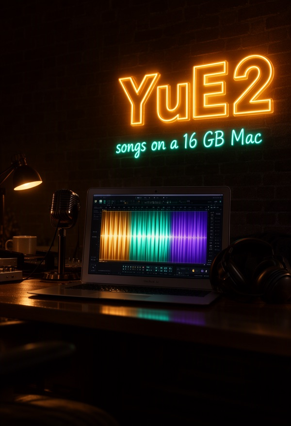
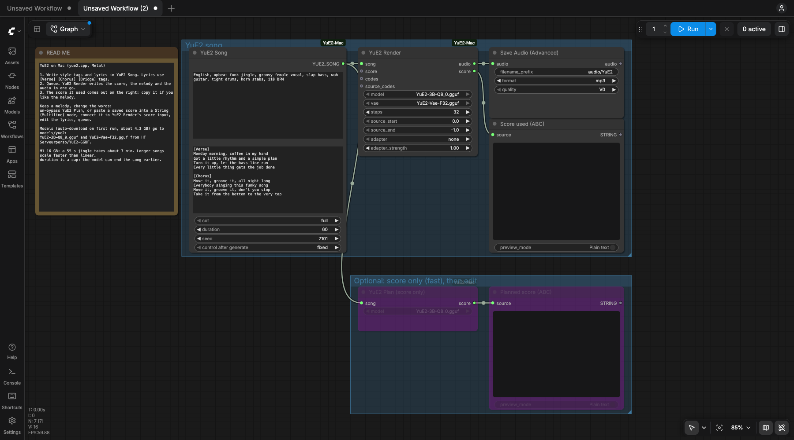
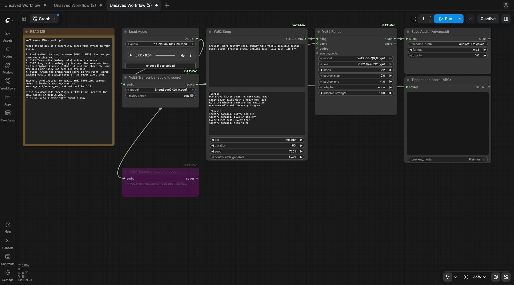

# ComfyUI-YuE2-Mac (16GB+ RAM, M1+)

YuE2 song generation in ComfyUI on Apple Silicon. Style tags and lyrics in, a full song with vocals out, as a normal ComfyUI `AUDIO`. Runs on [yue2.cpp](https://github.com/ServeurpersoCom/yue2.cpp) with Metal, not PyTorch, so it fits a 16 GB Mac.

Tested on an M1 MacBook Air 16 GB (macOS 26.3). Demos and workflow downloads on [Civitai](https://civitai.com/models/3015968).






## Install
1. `brew install cmake` and `xcode-select --install` if you don't have them.
2. Clone into `ComfyUI/custom_nodes/` and build (about 1 min on an M1):
   ```sh
   cd ComfyUI/custom_nodes
   git clone https://github.com/Bambushu/ComfyUI-YuE2-Mac
   bash ComfyUI-YuE2-Mac/build.sh
   ```
   ComfyUI-Manager runs the build for you through `install.py`.
3. Restart ComfyUI and load `workflows/YuE2_Mac.json` (song from text) or `workflows/YuE2_Mac_Cover.json` (cover a recording).

Models download on the first run (about 4.3 GB) into `models/yue2/`, from HF [Serveurperso/YuE2-GGUF](https://huggingface.co/Serveurperso/YuE2-GGUF):
- `YuE2-3B-Q8_0.gguf` (3.8 GB), near lossless
- `YuE2-Vae-F32.gguf` (0.5 GB)

## Nodes
- **YuE2 Song**: style, lyrics (`[Verse]`, `[Chorus]`, `[Bridge]`...), cot, max duration, seed.
- **YuE2 Render**: writes the score, the melody and the audio. Outputs `audio` and the `score` it used.
- **YuE2 Plan (score only)**: writes the ABC score alone, in seconds. Connect it (or any edited score) to YuE2 Render's `score` input to keep a melody and change the words, seed or steps.
- **YuE2 Transcribe (audio to score)**: SheetSage2 writes the score of a recording. Melody only + `cot` melody on YuE2 Song = a cover: the original melody, your lyrics and style.
- **YuE2 Tokenize (audio to codes)**: the recording as YuE2 codes, 25 per second. Into Render's `source_codes` with `source_start`/`source_end`: the new song starts with that section and grows from it. Into `codes`: the recording re-rendered through YuE2, with the `nar_lora_joint_v9` realaudio adapter.

The audio nodes download SheetSage2, MERT and the tokenizer (about 1 GB) on first use; the adapter comes from HF [Mothersuperior/yue2-mothersuperior-realaudio-tokenizer-v4](https://huggingface.co/Mothersuperior/yue2-mothersuperior-realaudio-tokenizer-v4) into `models/yue2/adapters/`.

Each node runs yue2.cpp in its own process: ComfyUI's models are unloaded first, and all memory comes back when the render ends. Cancel works.

## Speed
| | M1 MacBook Air 16 GB | M5 Pro 48 GB |
|---|---|---|
| Software | these nodes, yue2.cpp Q8 on Metal | official YuE2 Python, PyTorch MPS, `--offload-ar` |
| Score only (YuE2 Plan) | ~30 s for a 55 s song, ~80 s for a 4 min song | ~2 min |
| 55 s song | 8m07s | not measured |
| Full song | 3:53 song in 54m20s | ~20-25 min |
| 55 s cover (Transcribe + Render) | 8m01s | transcription alone 1-3 min |
| Extend: 20 s kept + 55 s new | 8m31s | not measured |
| Re-render a 55 s recording (codes + realaudio adapter) | 6m03s | not measured |
| Peak memory, whole system | 11.8-13.5 GB, no swap on any run | |
| Longest song | 3:53 tested | out of memory above ~5:30 |

The columns are different software, so this is not a chip-vs-chip race: the M5 column is how covers were made before this pack existed.

The acoustic stage is most of the time and grows faster than the song length. Steps lower it (`steps` on YuE2 Render, default 32).

## Tips
- Write the arc in the style: "sparse verse 1, band from verse 2, biggest final chorus".
- One lyric section per sung section: an extra `[Bridge]` shifts everything after it.
- Same score, other seed: same section timing, so takes splice cleanly.
- Close other heavy apps on 16 GB.

## License
Nodes: MIT. yue2.cpp: MIT. YuE2, SheetSage2, MERT weights and the Mothersuperior tokenizer and adapter: CC-BY-NC-4.0 (non-commercial). Cover only recordings you have the rights to.
